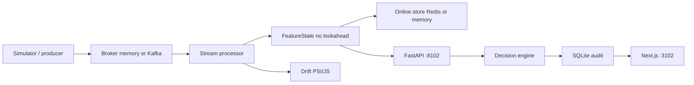
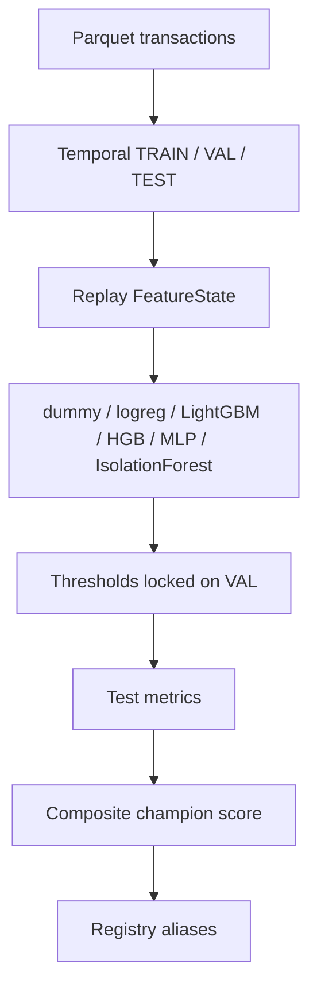

# SentinelML architecture

Subtitle: Real-Time Fraud Detection, Streaming Feature Engineering, Model Monitoring and Automated MLOps.

## Problem

Card and account-takeover fraud is rare, delayed to label, and arrives as a stream. A batch-trained classifier that shuffles rows will leak future merchant rates and customer velocity into the past. SentinelML is a research-scale platform that keeps **training and serving on the same chronological feature state machine**, with a decision engine that is not the model.

## Streaming + serving

## Retrain loop

## Stack

| Layer | Implementation |
|---|---|
| Data | Handbook-style simulator (`scripts/generate_data.py`) |
| Features | `FeatureState` + Feast repo layout |
| Models | sklearn, LightGBM, PyTorch MLP, Isolation Forest |
| Serving | FastAPI 8102 |
| UI | Next.js App Router 3102 |
| Tracking | MLflow file store / compose 5102 |
| Stream | Kafka client + in-process broker |
| Audit | SQLite locally; Postgres+Alembic in compose `full` profile on **5433** (does not bind host :5432) |

## Ports

API 8102, dashboard 3102, MLflow 5102, Kafka 9092 only if the broker is started.

## What was not run here

Kafka live broker (Docker daemon down at discovery). Feast `feast apply` is optional. Host Redis :6379 may be used; smoke falls back to in-memory online store. No NVIDIA GPU; no cloud spend.
