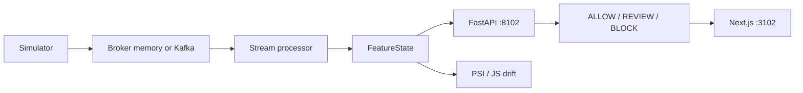

# SentinelML

**Real-Time Fraud Detection, Streaming Feature Engineering, Model Monitoring and Automated MLOps Platform**

Card fraud is rare, labels arrive late, and a shuffled train/test split will leak future merchant risk into the past. SentinelML is a research-scale, independently runnable platform: a Handbook-style simulator, a single chronological `FeatureState` for training and serving, a model zoo with locked validation thresholds, a decision engine separate from the classifier, an inference API, stream processing with a pluggable broker, drift detection, and a monitoring dashboard.

## Measured results

Copied from `artifacts/*.json` on this Apple M4 host (no NVIDIA GPU). Re-run `make smoke` on another machine rather than copying these numbers.

| Item | Value | Source |
|---|---|---|
| Champion | XGBoost (`xgboost`) | `artifacts/champion.json` |
| Challenger | PyTorch MLP (`mlp_torch`) | `artifacts/registry.json` |
| Test PR-AUC | 0.8083 | `artifacts/champion.json` |
| Test ROC-AUC | 0.9216 | `artifacts/metrics.json` (champion.test) |
| Test precision / recall / F1 | 0.5614 / 0.8421 / 0.6737 | `artifacts/metrics.json` |
| Test FPR | 0.0225 | `artifacts/champion.json` |
| Confusion (TN/FP/FN/TP) | 1088 / 25 / 6 / 32 | `artifacts/metrics.json` |
| Expected cost (FP=1, FN=25 assumptions) | 175.0 | `artifacts/champion.json` |
| Operating threshold | 0.2648 (`minimize_configured_cost` on VAL) | `artifacts/champion.json` |
| Calibration | none (Platt/isotonic did not improve VAL Brier without hurting business metrics) | `artifacts/champion.json` |
| Selection score | 0.8665 (PR-AUC + recall + inverted FPR + inverted cost + latency + memory) | `artifacts/champion.json` |
| Temporal split | TRAIN 2025-01-01 → 2025-02-23 (3608 rows) · VAL → 2025-03-13 (1241) · TEST → 2025-03-31 (1151) | `artifacts/split_manifest.json` |
| Stream demo | 500/500 events, 99.97 events/s at target 100/s, 30 alerts, 0 errors. Kafka **not** started. | `artifacts/stream_demo.json` |
| Drift demo | `drift_detected: true` (PSI/JS); amount, hour, merchant stats alerted | `artifacts/drift_report.json` |
| API TestClient load | 200 req, 0 errors, 319.1 rps, p50 2.87 ms, p95 4.17 ms, p99 4.67 ms | `artifacts/benchmark.json` |
| Tests | 34 passed, 0 failed (4.68 s) | `artifacts/test_results.json` |

Test-set comparison (`artifacts/model_comparison.csv`):

| Model | PR-AUC | Recall | FPR | Expected cost | selection_score |
|---|---|---|---|---|---|
| xgboost (champion) | 0.8083 | 0.8421 | 0.0225 | 175.0 | 0.8665 |
| mlp_torch | 0.8070 | 0.8684 | 0.0512 | 182.0 | 0.8601 |
| lightgbm | 0.8185 | 0.8158 | 0.0270 | 205.0 | 0.8586 |
| hist_gradient_boosting | 0.7751 | 0.8421 | 0.0225 | 175.0 | 0.8547 |
| logistic_regression | 0.7459 | 0.7895 | 0.0332 | 237.0 | 0.8214 |
| rule_amount | 0.6760 | 0.6579 | 0.0009 | 326.0 | 0.7595 |
| mlp_sklearn | 0.6136 | 0.6053 | 0.0063 | 382.0 | 0.7162 |
| isolation_forest | 0.1762 | 0.7368 | 0.2075 | 481.0 | 0.5393 |
| dummy_majority | 0.0330 | 1.0000 | 1.0000 | 1113.0 | 0.3116 |

LightGBM had the highest PR-AUC (0.8185) but lost the composite score to XGBoost (lower cost, lower FPR, lower latency/memory). Isolation Forest is **not** claimed better than supervised models. Throughput is **not** 5000 TPS; the stream demo was paced at 100 events/s.

## Architecture



Retrain: validate → train candidates → lock thresholds on VAL → test → composite selection → promotion gate → MLflow aliases `champion` / `challenger`.

## Stack

Python 3.11 (uv), pandas, scikit-learn, LightGBM, XGBoost, PyTorch MLP, FastAPI, Next.js, MLflow, optional Redis, Kafka client, SQLite audit.

## Quickstart

```bash
uv python pin 3.11
uv sync --extra dev
make smoke          # data + train + evaluate + unit tests
make stream-demo    # in-process broker; Kafka not required
make drift-demo
make serve          # API :8102
make ui             # dashboard :3102
```

## NVIDIA GPU (large simulator)

On a Linux machine with an NVIDIA GPU:

```bash
git clone https://github.com/rohansonawane/sentinelml-fraud-platform.git
cd sentinelml-fraud-platform
make gpu-setup && make gpu-check
make gpu-data
make gpu-train
make gpu-eval
make gpu-serve
```

~200k transactions + GPU XGBoost / larger MLP. Million-row: `make gpu-data-full` then `make gpu-train GPU_CONFIG=configs/cuda/full.yaml`. Details: [GPU_SETUP.md](GPU_SETUP.md). GPU metrics live in `artifacts/gpu/`, not in the Mac table above.

## Limitations

- Synthetic / research data. Not a bank portfolio.
- FP=1, FN=25 are **modeling assumptions**, not issuer costs.
- Fraud evolves; this snapshot will drift.
- Kafka was **not started** on the Mac (Docker daemon down at discovery); `make stream-demo` uses the in-process queue.
- CUDA training is for an NVIDIA box — see [GPU_SETUP.md](GPU_SETUP.md). Not run on this Mac.
- Feast layout is real; smoke uses the compatible OfflineStore/OnlineStore in `sentinelml.features.store`. SHAP and Evidently were not installed; tree importances / PSI-JS are the fallbacks.
- BLOCK is not a production payment action without legal/business validation.

## License

MIT. See `ARCHITECTURE.md`, `DATASET_CARD.md`, `MODEL_CARD.md`, `REPRODUCIBILITY.md`, `INTERVIEW_GUIDE.md`.
