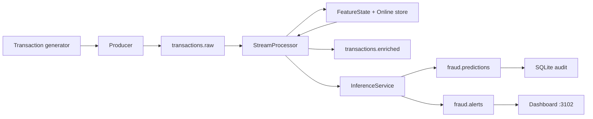

# Streaming architecture

Transaction generator → broker (`transactions.raw`) → `StreamProcessor` (features + optional score) → `transactions.enriched` / `fraud.predictions` / `fraud.alerts`.

**Broker:** Kafka client is implemented. Docker daemon was down at discovery, so smoke and `make stream-demo` use the in-process queue (`InMemoryBroker`). Kafka was not started.

JSON schema: `schema_version`, `event_id`, `transaction_id`, `event_time`, `customer_id`, `merchant_id`, `amount`.
